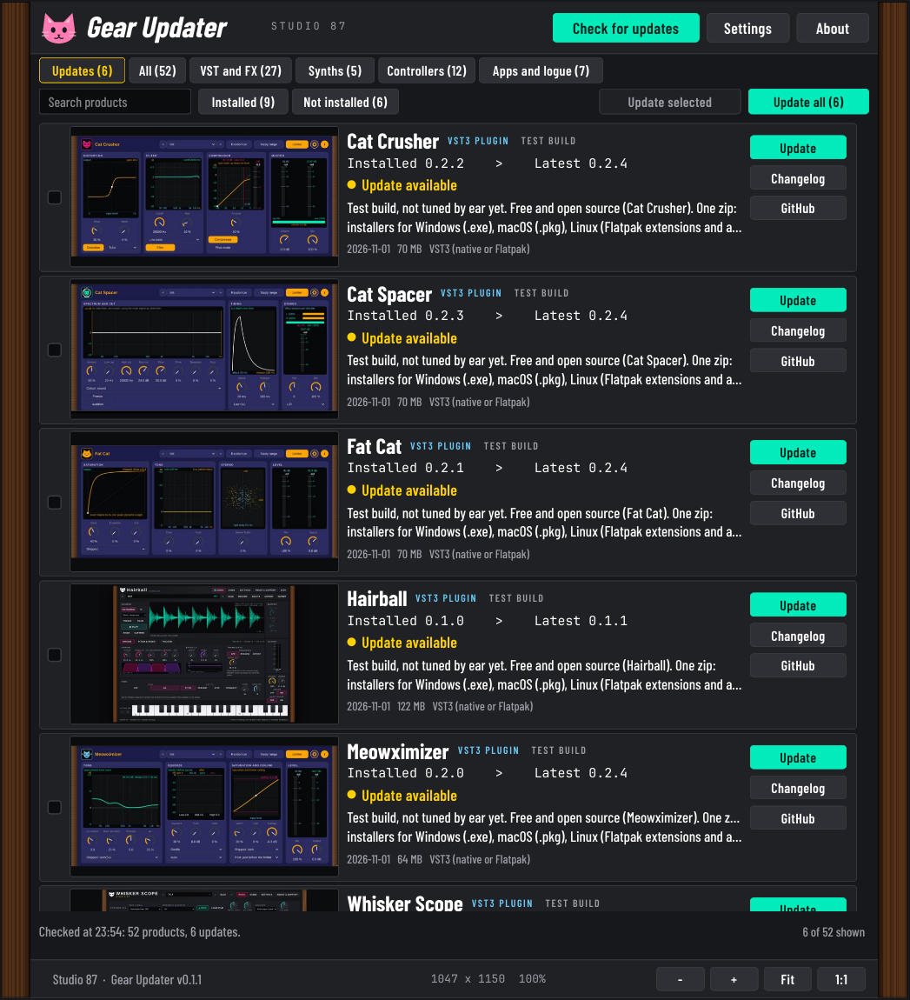

# Studio 87 Gear Updater

One window that lists every Studio 87 plugin, VST, FX and app, shows which ones have a newer version on GitHub, and updates them one by one, several at once, or all together. Free and open source, made mainly for the author, so it is built to be quick.



*The screenshot is the real window rendered offscreen with recorded GitHub data for the products that were recorded; the "installed" versions are staged on purpose so every state shows (see Honest status).*

**TLDR**
- A list: a 310 x 162 screenshot on the left, at most six lines on the right (name and kind, installed and latest version, status, a two-line description, date, size and install route). Buttons: Update or Install, Changelog, GitHub.
- The full public Studio 87 catalog in one scrolling list (mouse wheel, drag or keys; no scrollbars). It opens on Updates, with an "Everything is up to date" screen when there is nothing to do. Search filters as you type. Tabs: Updates, All (updates first, then by name), VST and FX, Synths, Controllers, Apps and logue, Installed, Not installed. Private and unavailable repos are never shown.
- Buttons say what they will do: Update all / Update selected only count real updates; on the Not installed tab it says Install all, and a row says Install; a mixed selection says Apply selected (N updates, M installs).
- It checks GitHub **only when you open it or click "Check for updates"**. No timers, no background polling, no auto-start.
- It **collects nothing**. The only network use is read-only requests for public GitHub data and the download of a release zip you chose. The User-Agent is the generic `Studio87-GearUpdater`.
- Nothing is installed without a click. Every download is checked against `SHA256SUMS` first and **refused on a mismatch**.
- Your presets and data folders are never touched. Offline is fine: it shows the saved list and says so.
- The installers are **not code-signed**; the app says so where it matters.

## Install (double click, no terminal)
Get `Studio87-Gear-Updater-vX.Y.Z.zip` from the Releases page (v0.1.0 was called `Studio87-Updater-v0.1.0.zip`), unzip, and follow `INSTALL.txt`:
- **Linux (Bazzite KDE and others):** double click `linux/Studio87-GearUpdater.flatpak`, then Install in the software centre.
- **Windows:** run `windows/Studio87-GearUpdater-Setup.exe` (unknown-publisher warning: More info, Run anyway).
- **macOS:** open `macos/Studio87-GearUpdater-macOS.pkg` (Privacy and Security, Open Anyway if blocked).

Each installer comes with an uninstaller that removes everything it installed; the updater's own settings stay unless you choose to delete them.

## How it works
1. On open it shows the list saved last time at once, then asks GitHub for the releases of every product in `studio87_updater/products.json` (one small read-only request per product, using ETags so unchanged answers cost nothing).
2. **Installed version** is read from what is really on the computer, never guessed: the VST3 bundle's own metadata (`moduleinfo.json`, or `Info.plist` on macOS), the Flatpak list, and the `installed-versions.json` this updater writes after it installs something (trusted only while the thing it installed is still there). Otherwise the row says *Not installed* or *Installed version unknown*.
3. **Update** downloads the release zip, verifies it, then follows the product's own `INSTALL.txt` route:
   - Linux: the VST3 tarball into `~/.vst3`, or the Flatpak extension if that product's extension is already installed (Settings can force either). Standalone apps: their Flatpak.
   - Windows: runs the release's `Setup.exe` silently. macOS: opens the `.pkg` in Installer.
   - Anything without a known installer (logue units, apps that ship an `install.sh`, a zip without the expected files): **guided**. It downloads and verifies, opens the folder, and shows you `INSTALL.txt`. It never runs scripts it does not know.
4. Verification (at least one source is required, all that exist must match): GitHub's own SHA-256 digest of the zip, a `SHA256SUMS` release asset that lists the zip, and the `SHA256SUMS` inside the zip for every file. The zip is unpacked safely (no path tricks, no symlinks, a plugin tarball must hold exactly one `.vst3` folder). These checks prove the download is intact and is what the release published; they are not a signature and do not prove who made it.

## Decisions (kept simple on purpose)
- **GUI toolkit: Qt 6 through PySide6 (Python).** Native on KDE, ships as a Flatpak on the KDE runtime and the PySide base app (no Qt bundled twice), as a PyInstaller build for Windows and macOS, and renders offscreen in CI for the screenshot and tests.
- **Layout:** ported from the approved mockup (`docs/mockup/updater-v9.html`, older versions in `docs/mockup/versions`). Default design size 1047 x 1150 (portrait), scaled down to fit your screen, never larger than it. Dragging a corner scales everything; a side changes only the width (960 to 1500) and the layout adapts; top or bottom changes only the height (760 to 1500) and shows more rows, text re-wraps and thumbnails keep their size. Double click on a wood side or Fit resets the size; 1:1 shows the design size. PurrOne wood sides, hover bubbles after one second, three looks in Settings (Neon Navy, Purple Soda Pop, PurrOne; PurrOne is the default).
- **Light:** no animation timers; the only timer is the one-second hover bubble. Network work runs on a thread pool; thumbnails are decoded as rows are shown.
- **Manifest:** `studio87_updater/products.json` maps repo to display name, kind (`vst3`, `controller`, `logue`, `app`, `unknown`), install method per OS, and where to look for the installed copy. Kinds and display names come from the repo names; `detect` hints (bundle and Flatpak names) were read from each product's own `release.yml` and are only filled in where that was done. Repos found on GitHub that are not in the file are listed as **view on GitHub**.
- **Catalog:** a scheduled workflow (`.github/workflows/catalog.yml`, every 3 hours) builds one `catalog.json` plus small thumbnails from the public API and publishes them on the `catalog` branch. The app fetches that single file by default (with ETag conditional requests), so it normally makes no API request per product and cannot hit the 60 per hour limit. If the catalog cannot be read it falls back to the API, one request per product, and stops asking when the limit is reached.
- **Optional sign in:** Settings, Sign in with GitHub (OAuth device flow, no permissions requested) raises the API limit to 5000 per hour. The token lives in your system keychain, is never written to a file and never logged. The app works the same without it. In the Flatpak the keychain module may be missing; then sign in is shown as off.
- **Install modes:** All users (default on Windows and macOS) or Just for me (Windows `%LOCALAPPDATA%\Programs\Common\VST3`, macOS `~/Library/Audio/Plug-Ins/VST3`, Linux `~/.vst3`). The Windows build starts with an administrator manifest, so there is one UAC prompt at start and none per install; macOS asks once per batch.
- **Screenshots:** each repo's `docs/screenshot.png`, cached locally. Products without one show a tinted "no screenshot yet" tile; nothing is faked.

## Develop
```
python3 -m unittest discover tests          # pure core + firmware checker + GUI smoke tests (GUI ones skip without PySide6)
python3 tools/mutation_check.py             # applies deliberate bugs one at a time; the tests must catch every one
python3 -m studio87_updater --list          # same checks in the terminal, no GUI
python3 -m studio87_updater                 # the window (needs PySide6)
QT_QPA_PLATFORM=offscreen python3 tools/make_screenshot.py    # renders the real window with recorded data
```
Releases: run the `release` workflow by hand with a tag (`inputs[tag]=v0.1.0`). It builds the Flatpak, the Windows installer, the macOS package and the PDF manual, and publishes one zip plus a separate `SHA256SUMS` asset as a pre-release.

## Honest status
Verified: the unit and GUI smoke tests, the deliberate-bug check, CI runs, and the offscreen render of the real window. Real GitHub data was read for the repos this development session could reach (15 products); a real network check works from the command line.
**Not verified:** a real install of a plugin on a real machine, the Flatpak (permissions, `flatpak-spawn --host`), Windows and macOS builds and installers, the macOS `.pkg` and uninstaller, and the Linux "Flatpak DAW" route. The `docs/screenshot.png` shows staged installed versions (a temporary fake VST3 folder with older version numbers) because the build machine has no real plugins installed. See `ROADMAP.md`.

## Also in this repo: firmware file checker (early)
`gear_updater/` is the earlier tool that checks firmware files and lists MIDI ports. It does not flash anything; each device's update protocol must first be captured and verified (see `docs/DESIGN.md`).
```
python3 gear_updater/gear_updater.py ports            # list ALSA MIDI ports (needs amidi)
python3 gear_updater/gear_updater.py dry-run FW.syx   # check a file and print what a flash would involve
```

## Privacy and licence
No telemetry, no account, no identifiers, no background activity. Fonts: Barlow Condensed and JetBrains Mono (SIL OFL, see `studio87_updater/assets`). Licence: AGPL-3.0-or-later. Support is optional: ko-fi.com/studio87.
